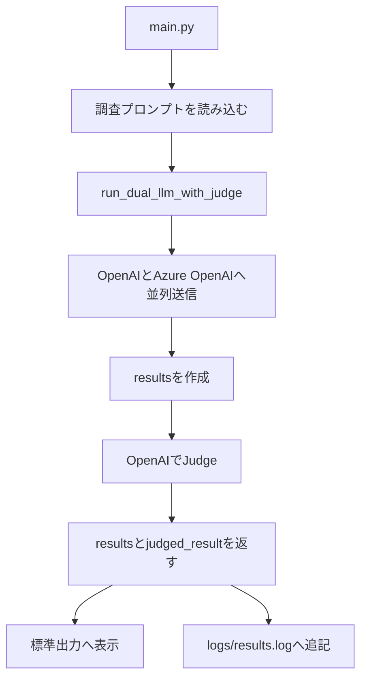

# 設計概要

## 目的

同じ調査プロンプトを OpenAI と Azure OpenAI に並列送信し、2つの回答を比較したうえで、OpenAIをJudgeとして採用回答を選定する。

対象テーマは、SES業界の将来予測と、今後必要とされるエンジニア人材像の分析である。

## 処理フロー



1. `main.py` が `prompt/ses_industry_analysis.md` を読み込む。
2. `run_dual_llm_with_judge(prompt)` を呼び出す。
3. `run_dual_llm()` が OpenAI と Azure OpenAI に同じプロンプトを並列送信する。
4. 2つの回答を `results` として保持する。
5. `judge_results(results)` が回答Aと回答Bを比較する。
6. Judgeの結果と元回答を標準出力およびログへ保存する。

## モジュールの責務

### `main.py`

アプリケーションの実行入口。担当範囲は以下に限定する。

- `.env` の読み込み
- 調査プロンプトの読み込み
- ラッパーの呼び出し
- 実行結果の整形
- 標準出力とログファイルへの出力

LLMの実行順序やJudgeの詳細は持たない。

### `dual_llm_wrapper.py`

LLM実行のオーケストレーションを担当する。

- `run_dual_llm(prompt)`
  - OpenAIとAzure OpenAIの接続を生成する
  - 2接続が揃っていることを確認する
  - `ThreadPoolExecutor(max_workers=2)` で並列実行する
  - 戻り値は `list[tuple[str, str]]`
- `judge_results(results)`
  - OpenAI接続をJudge専用に生成する
  - 2つの回答をJudge用プロンプトへ埋め込む
  - 優れた回答を返す
- `run_dual_llm_with_judge(prompt)`
  - 上記2処理を「LLM回答の生成 → Judge」の順に連携する
  - `main.py` から呼び出すユースケース単位の入口

### `llm_factory.py`

接続情報とOpenAI互換Chat Completions API呼び出しを管理する。

- `LLMConnection` で接続名、URL、APIキー、モデルを保持する
- OpenAIは `OPENAI_API_KEY` と `OPENAI_MODEL` を使用する
- Azure OpenAIは `AZURE_OPENAI_API_KEY`、`AZURE_OPENAI_ENDPOINT`、`AZURE_OPENAI_DEPLOYMENT` を使用する
- API呼び出しのタイムアウトは120秒
- APIエラーは接続名とエラー内容を含む回答文字列として返す

## 回答データの形式

`results` は以下の形式である。

```python
[
    ("OpenAI", "OpenAIの回答"),
    ("Azure OpenAI", "Azure OpenAIの回答"),
]
```

Judgeの結果も同じ形式で、名前は `Judge（OpenAI）` とする。

```python
("Judge（OpenAI）", "選定された回答")
```

接続生成の順序がOpenAI、Azure OpenAIであるため、Judgeプロンプト上では通常OpenAIが回答A、Azure OpenAIが回答Bになる。

## Judge設計

Judge用プロンプトは [prompt/judge_ses_industry_analysis.md](prompt/judge_ses_industry_analysis.md) に外部化している。

主な評価基準は以下のとおり。

- 前提と根拠に基づく論理性
- 分析の具体性
- SES現場のリアリティ
- 網羅性
- 実行可能な提案
- 将来予測の不確実性とリスクへの言及

運用上の方針として、OpenAIの回答（回答A）を第一候補とする。同程度または差が小さい場合は回答Aを選び、回答Bは回答Aに明らかな重大欠陥がある場合だけ選ぶ。これにより、同程度の回答では約9割をOpenAI側に寄せる。

この比率はLLMへのプロンプト指示による目安であり、厳密な確率制御ではない。

## プロンプトの管理

- 調査用プロンプト: `prompt/ses_industry_analysis.md`
- Judge用プロンプト: `prompt/judge_ses_industry_analysis.md`
- Judge用プロンプトはUTF-8で読み込む
- `{name_a}`、`{answer_a}`、`{name_b}`、`{answer_b}` を実行時に置換する

プロンプトを変更しても、Pythonコードを変更せずに評価方針や調査観点を調整できる。

## ログ設計

実行結果は `logs/results.log` に追記する。

1回の実行ごとに以下を保存する。

- 実行日時（タイムゾーン付きISO形式）
- OpenAIの回答
- Azure OpenAIの回答
- Judge（OpenAI）が選定した回答

同じ結果を標準出力にも表示する。ログディレクトリが存在しない場合は、実行時に自動作成する。

## 設定

`.env` またはシェル環境変数で設定する。

| 変数 | 用途 | 必須 |
| --- | --- | --- |
| `OPENAI_API_KEY` | OpenAI APIキー | 必須 |
| `OPENAI_MODEL` | OpenAIモデル名 | 任意。既定値は `gpt-4o-mini` |
| `AZURE_OPENAI_API_KEY` | Azure OpenAI APIキー | 必須 |
| `AZURE_OPENAI_ENDPOINT` | Azure OpenAIエンドポイント | 必須 |
| `AZURE_OPENAI_DEPLOYMENT` | Azure OpenAIデプロイメント名 | 必須 |

OpenAIとAzure OpenAIの2接続が揃わない場合、2つの回答を比較できないため実行を終了する。

## エラー処理

- 2つのLLM接続が揃わない場合は `RuntimeError` として終了する
- Judge用のOpenAI接続がない場合は `RuntimeError` として終了する
- Judge対象の回答数が2件でない場合は `RuntimeError` として終了する
- API呼び出しの通信・レスポンスエラーは、`llm_factory.py` がエラー内容を回答文字列として返す
- ログファイルの作成・書き込みに失敗した場合は標準エラー出力へ通知して終了する

## 実行方法

```bash
python main.py
```

外部APIを利用するため、必要な環境変数を設定してから実行する。
